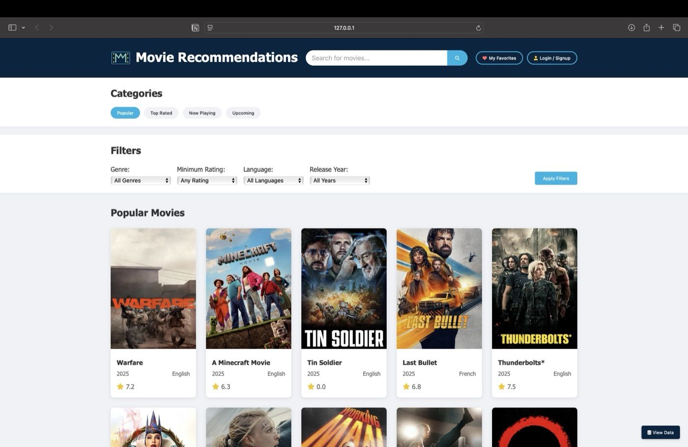
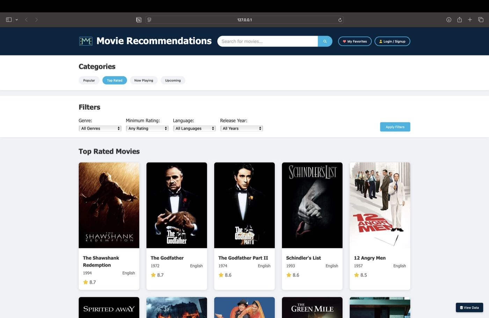
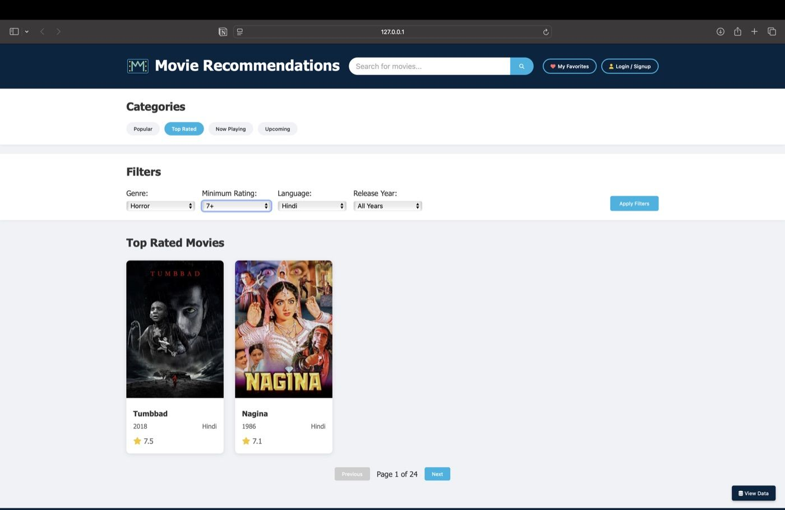

# Movie Recommendation Website


A responsive movie recommendation website that uses the TMDB (The Movie Database) API to display movie information, ratings, and allows filtering and searching for movies.

## Screenshots





## Features

- Browse popular, top-rated, now playing, and upcoming movies
- Search for movies by title
- Filter movies by:
  - Genre
  - Rating
  - Language
  - Release year
- View detailed movie information:
  - Plot summary
  - Cast and director
  - Ratings
  - Release date and runtime
- Watch movie trailers directly on the website
- User authentication system (signup/login)
- Add movies to your favorites list
- Write and read reviews for movies
- Responsive design for mobile and desktop
- Pagination for browsing through large sets of results
- Logo redirects to home page

## Setup Instructions

1. **Get a TMDB API Key**:
   - Go to [https://www.themoviedb.org/](https://www.themoviedb.org/) and create a free account
   - After logging in, go to your account settings by clicking on your profile picture
   - In the left sidebar, click on "API"
   - Click on "Create" under "Request an API Key"
   - Select "Developer" option
   - Fill out the form with your details
   - Accept the terms of use and click "Submit"
   - You'll receive an API key

2. **Configure the API Key**:
   - Open the file `js/config.js`
   - The repository ships with the placeholder `'YOUR_API_KEY'`. Replace it with your actual TMDB API key:
   ```javascript
   const config = {
       apiKey: 'YOUR_ACTUAL_API_KEY_HERE',
       // rest of the config...
   };
   ```

3. **Run the Website**:
   - You can use any local server to run the website
   - For example, with Python:
     ```
     cd /path/to/movie-recommendation-system
     python -m http.server 8000
     ```
   - Or with Node.js and the `http-server` package:
     ```
     npm install -g http-server
     cd /path/to/movie-recommendation-system
     http-server
     ```
   - Then open your browser and go to `http://localhost:8000`

## Technologies Used

- HTML5
- CSS3
- JavaScript (ES6+)
- TMDB API
- Font Awesome for icons

## Project Structure

- `index.html` - Main HTML file
- `css/style.css` - Styling for the website
- `js/config.js` - Configuration file for TMDB API
- `js/app.js` - Main JavaScript file with application logic
- `js/movies-data.js` - Local fallback movie data

## Credits

- Movie data provided by [The Movie Database (TMDB)](https://www.themoviedb.org/)
- This product uses the TMDB API but is not endorsed or certified by TMDB.

## License

This project is open source and available under the [MIT License](LICENSE).